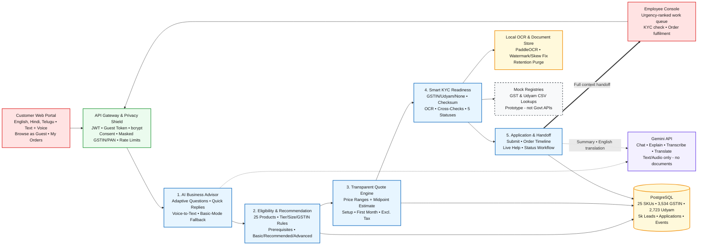

# Airtel SYNC – HLD (presentation version, as implemented)

**Key principle:** the AI understands and explains; the backend decides. Eligibility, prices, KYC status and application status are deterministic backend rules. Gemini never sees document images or raw identifiers.
