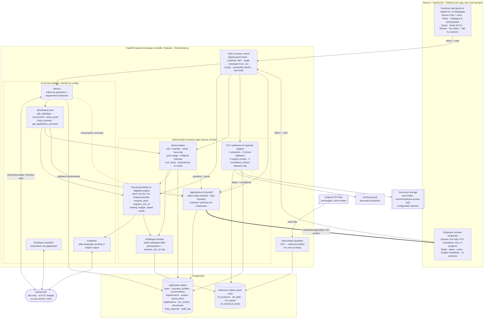
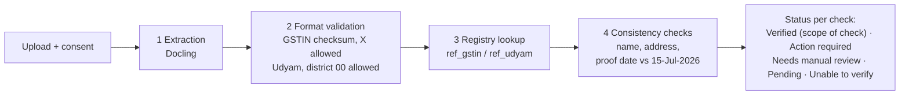

# Airtel SYNC – High-Level Design (HLD)

Prototype only. All data is synthetic. Not an official Airtel product. No live government integrations.

## System overview



## Phase 2 additions
- Guests can browse, chat, see plans, build a quote and ask for help; sign-in is required at verification. Guest work is merged into the account.
- "My orders" timeline (`application_events`) and resume of drafts. Live help requests reach the employee queue immediately.
- KYC registration type: GSTIN, Udyam, both or neither.
- 10-language UI (next-intl) with backend message codes; Gemini replies in the customer's language, translates catalogue descriptions (cached) and transcribes voice (in memory).
- PaddleOCR runs locally with watermark removal and de-skew; documents never go to the AI service.
See `LLD/` for sequence, AI, KYC and database details.

## Responsibility split

| Decides | Owner |
|---|---|
| Eligibility, dependencies, prices, quote totals | Backend code only |
| KYC statuses and review flags | Backend code only |
| Application status transitions and access control | Backend code only |
| Understanding messages, follow-up questions, requirement extraction | Gemini |
| Plain-language explanation and summaries | Gemini, from backend output |

Gemini receives sanitised text only and can call only the whitelisted tools. It has no SQL access and cannot approve KYC or applications.

## Main customer-to-employee flow

```mermaid
flowchart LR
    A["Customer describes business"] --> B["Advisor asks follow-ups"]
    B --> C["Backend validates<br/>extracted requirements"]
    C --> D["Eligibility engine<br/>recommends products"]
    D --> E["Prerequisites &<br/>add-ons shown"]
    E --> F["Customer selects products"]
    F --> G["Quote engine<br/>(range + midpoint estimate)"]
    G --> H["KYC readiness checks"]
    H --> I{"Issues?"}
    I -->|fixable| H
    I -->|needs help| J["Help request"]
    I -->|clear| K["Submit application"]
    J --> K
    K --> L["Employee reviews<br/>full context"]
```



## KYC pipeline (dataset rules only)



Anything the dataset cannot support (for example signatory verification, since the registries have no signatory column) is marked **Pending / Needs manual review**. OCR output is never treated as proof of authenticity.

## Planned project structure

```
Hackthon_Project/
├── .env.example            # placeholders only
├── .gitignore              # .env, uploads/, node_modules, venv
├── PROJECT_STATUS.md
├── DECISIONS.md
├── docs/architecture/
│   ├── HLD.md
│   └── LLD/ customer-flow.md · ai-workflow.md · product-recommendation.md · kyc-workflow.md · database.md
├── 6ae1873397bc1_digital/  # supplied data, untouched
├── backend/
│   ├── app/
│   │   ├── main.py · config.py · db.py
│   │   ├── auth/           # JWT, hashing, role + ownership deps
│   │   ├── models/ schemas/
│   │   ├── catalogue/ recommend/ quote/ kyc/ applications/ employee/
│   │   └── ai/             # adapter, prompts, tools (separate from business logic)
│   ├── scripts/            # load_reference_data.py (pandas), seed_demo_users.py
│   └── tests/
└── frontend/
    └── src/app/
        ├── login/
        ├── customer/       # advisor · catalogue · quote · kyc · applications
        └── employee/       # dashboard · application/[id]
```

## Notes
- Docling is the preferred extractor. It will be tested against the sample images first; if it cannot read them reliably, the fallback is to tell you before swapping.
- Quotes show price ranges per unit. The single estimate is the midpoint, labelled "estimate". All prices are excl. taxes.
