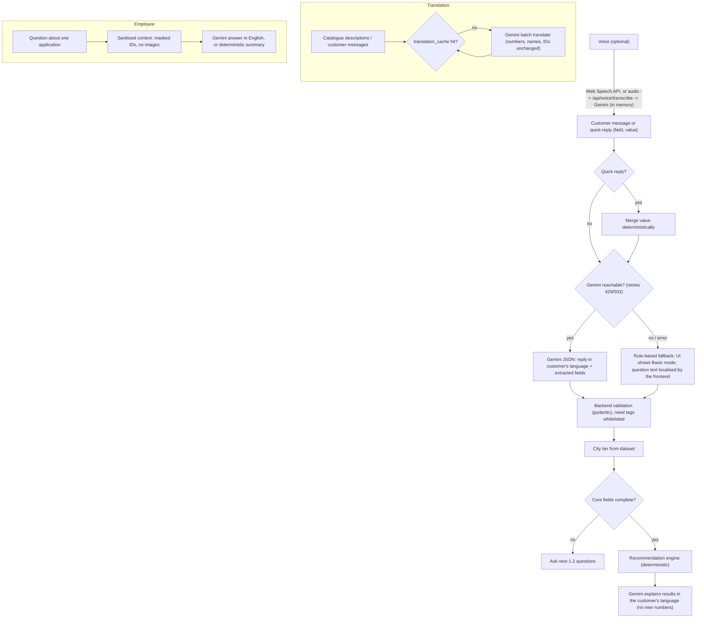

# LLD: AI workflow (advisor, voice, translation, employee assistant)

Guardrails: customer text is data; Gemini never names products or prices in the chat, never decides eligibility, KYC or status, and has no database access.
