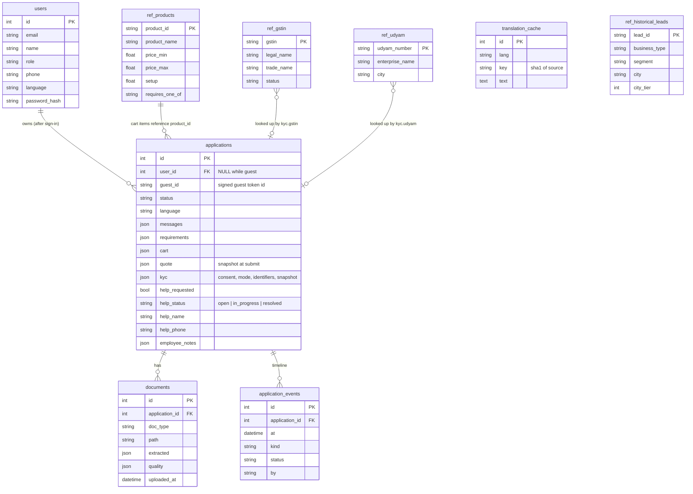

# LLD: Database

`ref_*` tables are loaded from the supplied CSVs and are read-only. Schema upgrades for existing databases are idempotent `ALTER ... IF NOT EXISTS` statements run at startup (`app/db.py`).
