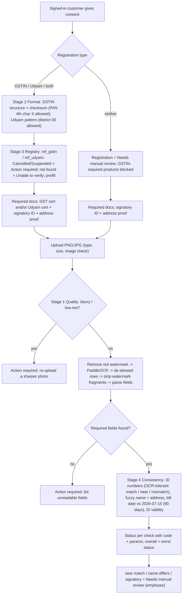

# LLD: KYC workflow

Statuses: Verified (within implemented checks), Action required, Needs manual review, Pending, Unable to verify. No LLM involved; documents never leave the server; no claim of authenticity or government verification.
