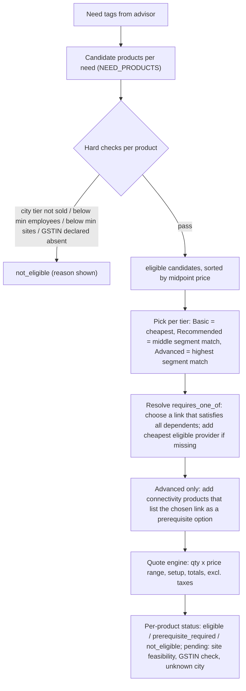

# LLD: Eligibility, dependencies and recommendation

Hard constraints: city tier, `min_employees`, `min_sites`, `requires_gstin`, `requires_one_of`. Preferences (segment match, budget) only rank or flag; budget never removes a product.
